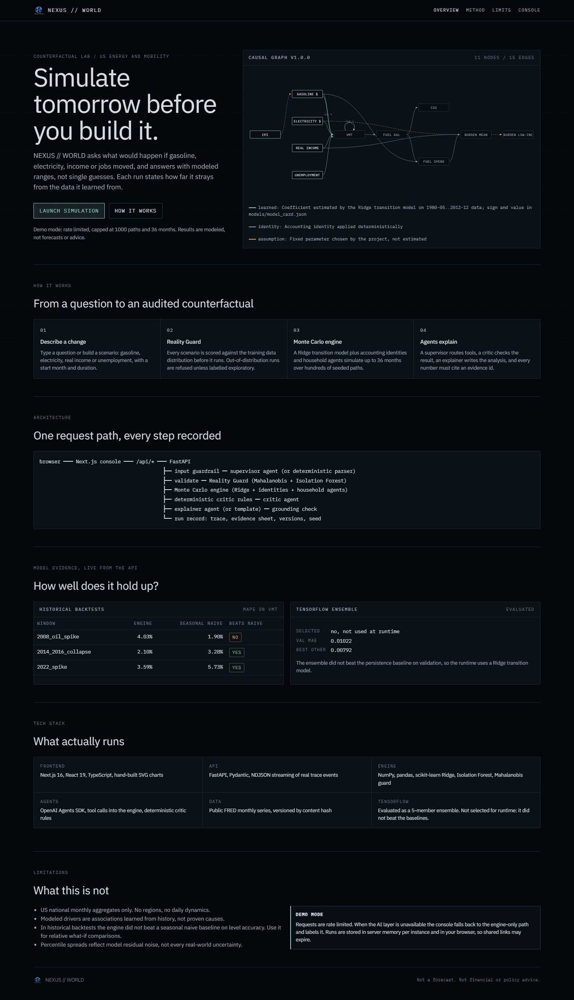
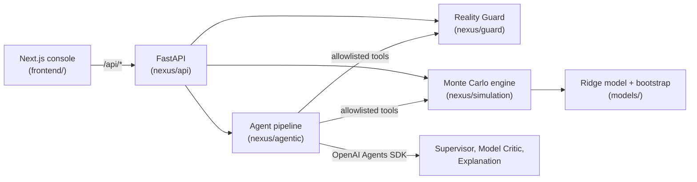

<p align="center">
  
</p>

<h1 align="center">NEXUS WORLD</h1>
<p align="center"><i>Simulate tomorrow before you build it.</i></p>

<p align="center">
  <a href="https://nexus-world-zeta.vercel.app"></a>
  
  
  
  
  
  
  
</p>

A counterfactual simulation lab for US energy and mobility, with uncertainty, extrapolation checks and audited AI explanations.

NEXUS WORLD answers "what if" questions about US driving, fuel, emissions and household energy costs. Every number comes from a computational engine; AI agents plan, critique and explain the result but never produce numbers themselves.

<p align="center">
  
</p>

## What It Does

You change a driver (gasoline price, electricity price, real income or unemployment) by an amount, from a start month, for a duration. The system simulates a baseline and your counterfactual over up to 36 months and reports how vehicle miles traveled, motor fuel use, CO2, fuel spending and household energy burden differ.

Results are percentile ranges (P10, P50, P90) across seeded Monte Carlo paths, not single guesses. Each run states how far the scenario strays from the data the model learned from, and anything outside that range is labelled exploratory.

## How It Works

**Question / Scenario → Reality Guard → Monte Carlo Engine → AI Agents → Grounding / Evidence → Audited Result**

1. **Question / Scenario:** a natural-language question is parsed into a typed intervention, or you build one directly.
2. **Reality Guard:** scores every simulated month against the training distribution (per-feature range, Mahalanobis distance, IsolationForest) and assigns a tier: HIGH, MEDIUM, LOW or OOD.
3. **Monte Carlo Engine:** a Ridge transition model plus accounting identities and household-type agents, run over bootstrap parameter draws and residual noise.
4. **AI Agents:** a Supervisor routes allowlisted tools; a Model Critic reviews reliability; an Explanation agent writes the analysis.
5. **Grounding / Evidence:** every number in the explanation must map to an evidence ID from a tool call, or the system falls back to a deterministic template.
6. **Audited Result:** metrics, fan charts, evidence, critic verdict and a timestamped agent trace under one run ID.

## Core Capabilities

- Counterfactual scenario simulation with up to 4 interventions and a 36-month horizon
- Reality Guard out-of-distribution detection with per-month tiers and reasons
- Monte Carlo uncertainty (up to 2000 paths, percentile spreads)
- Ridge transition model on year-over-year VMT growth
- Accounting identities for fuel, CO2, spending and energy burden
- Household agents: 9 types (3 income groups by urban, suburban, rural)
- Grounded AI explanation with a deterministic critic floor and engine-only fallback
- Evidence IDs and run IDs for traceability
- Scenario comparison (baseline plus up to three scenarios)
- Policy Arena: weighted multi-objective ranking with a Pareto front

## Architecture



Both services deploy as one Vercel project using Vercel Services: Next.js serves the site and `/api/*` routes to the Python service. See [docs/DEPLOYMENT.md](docs/DEPLOYMENT.md).

## Model & Data

- **Data:** six public monthly series from FRED: gasoline and electricity prices, CPI (BLS), real disposable income (BEA), unemployment (BLS) and vehicle miles traveled (FHWA). Missing values are dropped, never interpolated.
- **Splits:** train 1980-05 to 2012-12, validation 2013-01 to 2017-12, test 2018-01 to 2026-08.
- **Model:** Ridge regression (alpha 30) on 12-month log growth of VMT, using price, income and unemployment changes plus lagged growth. Uncertainty comes from 200 block-bootstrap parameter draws and out-of-fold residuals.
- **Evaluation:** on validation, Ridge has MAE 0.0089 against 0.0079 for simple persistence and 0.0173 for seasonal naive. Its 80% interval covers 93% of validation months but 70% of test months (84% excluding COVID).
- **Backtests (24-month level MAPE):** 2008 oil spike 4.0% (seasonal naive 1.9%, the engine loses), 2014 to 2016 collapse 2.1%, 2022 spike 3.6% (best of the three methods).
- **TensorFlow:** a Ridge plus TF residual ensemble was evaluated offline (validation MAE 0.0102) and not selected. TensorFlow is not in the runtime.

## Tech Stack

Python 3.13, NumPy, pandas, scikit-learn, FastAPI, Pydantic, OpenAI Agents SDK (gpt-6-luna) · Next.js 16, React 19, TypeScript · pytest, Vitest, Playwright · Vercel Services.

## Quick Start

```bash
python -m venv .venv && .venv/bin/pip install -r requirements-dev.txt   # Windows: .venv\Scripts\pip
.venv/bin/python -m pytest
.venv/bin/uvicorn nexus.api.vercel_app:app --port 8000
cd frontend && npm ci
NEXUS_BACKEND_URL=http://127.0.0.1:8000 npm run build && NEXUS_BACKEND_URL=http://127.0.0.1:8000 npm start
```

Copy `.env.example` to `.env` and set `OPENAI_API_KEY` for AI mode. Without a key the app runs engine-only. Set `NEXUS_ENABLE_DOCS=1` locally to enable the API docs pages.

## Limitations

- US national monthly aggregates only; no regional or individual-level detail.
- Modeled associations, not proven causal effects. Household-agent parameters are documented assumptions, not estimates.
- Historical level accuracy is modest: the engine does not beat seasonal naive in the 2008 backtest.
- Percentile spreads reflect model and parameter uncertainty only and under-cover in the test period.
- Public demo: rate limited, capped at 1000 paths per analysis; runs are stored in memory per instance, so shared run links may expire.
- AI analysis depends on OpenAI availability; when it fails the console falls back to engine-only or partial fallback and labels it.

Outputs are simulations under stated assumptions, not forecasts or advice.

## Documentation

[Data and model](docs/DATA-AND-MODEL.md) · [Engine and API](docs/PHASE-2-IMPLEMENTATION.md) · [Agent layer](docs/PHASE-3-AGENTS.md) · [Frontend](docs/PHASE-4-FRONTEND.md) · [Deployment](docs/DEPLOYMENT.md)

## License

No license file is included; all rights reserved.

## Author

Shahil ([@shahil5z](https://github.com/shahil5z)). A Data Science portfolio project.
